


  

Software Engineering student building backend systems with <b>Java</b>, <b>Spring Boot</b> and <b>MySQL</b>. 
I learn by building — from the logic to the interface — and I'm looking for my first role as a Java / Backend Developer.

 

 


  

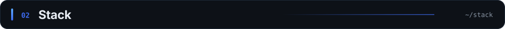

 

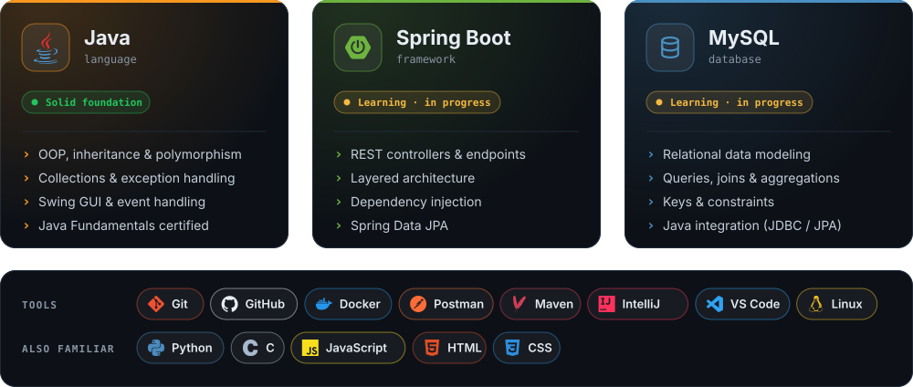

  

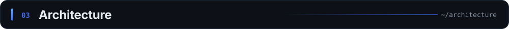

 


The layered architecture I'm focused on building and mastering with Spring Boot.

  

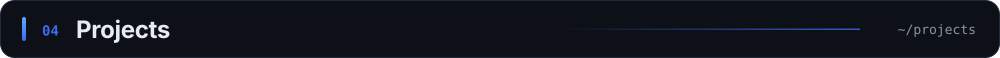

 

  <a href="https://github.com/ndu-xl/projeto-calculadora-swing"></a>
  <a href="https://github.com/ndu-xl/jogo-da-velha-pygame"></a>

  

 

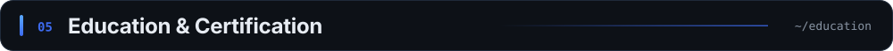

 

  

 

  
  
  
  

 

